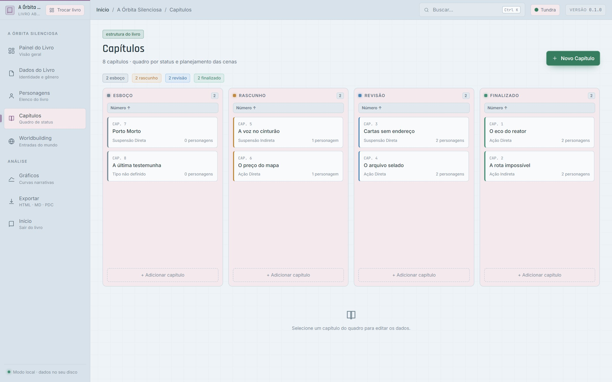
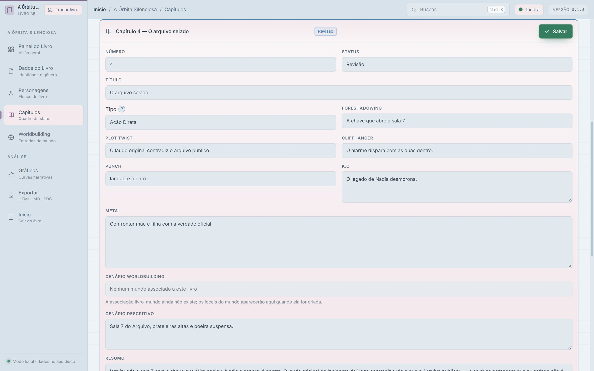
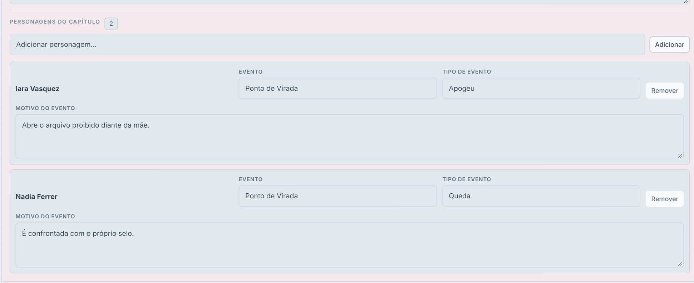

# Capítulos no TaleCraft: o quadro de status chegou

**Subtítulo:** Planeje a estrutura do livro em quatro etapas, com arco de personagem por capítulo.

**Tags sugeridas:** escrita, planejamento, ficção científica, fantasia, terror, ferramentas

---

O TaleCraft agora tem uma seção de **Capítulos** de verdade. Ela substitui a tela informativa que existia desde o começo do projeto.

A ideia é simples: o livro aberto ganha um quadro com quatro colunas — **Esboço**, **Rascunho**, **Revisão** e **Finalizado**. Cada coluna tem altura fixa, rolagem própria e um botão **Adicionar Capítulo** no rodapé, que já cria o capítulo naquele status. O botão **Novo Capítulo**, no cabeçalho, sempre cria no Esboço.

*O quadro de capítulos no tema Tundra: quatro status, colunas fixas e rolagem própria.*

Dá para ordenar cada coluna por **Número** ou **Data de Criação**, em ordem crescente ou decrescente, e arrastar os cards entre as colunas para mudar o status. Se o capítulo estiver aberto no painel, o campo **Status** acompanha o movimento.

Ao clicar em um capítulo, o painel de edição abre logo abaixo do quadro, com **Salvar** no canto superior direito do cabeçalho. Os campos cobrem o planejamento da cena:

- Número (somente dígitos, único por livro) e Título
- Status e Tipo — Ação Direta, Ação Indireta, Suspensão Direta ou Suspensão Indireta
- Meta, Foreshadowing, Plot Twist, Cliffhanger, Punch e K.O
- Cenário de Worldbuilding e Cenário Descritivo
- Resumo longo

*O painel abre abaixo do quadro, com Salvar no cabeçalho e os campos de planejamento da cena.*

O campo **Tipo** tem um botão de ajuda que explica cada conceito em linhas separadas: **Ação** move a trama para a conclusão; **Suspensão** prepara ou informa sem avançar; **Direto** é quando o protagonista atua; **Indireto** é quando outro personagem atua.

## Personagens e arco narrativo

Os **personagens do capítulo** vêm do elenco do livro. Para cada um, o escritor define o **Evento** — Neutro, Ponto de Ligação ou Ponto de Virada —, o **Tipo de Evento** correspondente (Ascensão/Declínio ou Apogeu/Queda) e o **Motivo do Evento**, explicando por que aquilo acontece na história.

*Cada personagem guarda o evento do arco, o tipo e o motivo daquele momento no capítulo.*

Essa combinação é o que permite acompanhar a curva de cada personagem capítulo a capítulo, sem perder de vista quem subiu, quem caiu e em que ponto da história isso aconteceu.

## Ajustes desta rodada

Depois dos primeiros testes, o formulário ficou mais compacto:

- o **K.O** foi para o lado do **Punch**, com altura curta;
- a ajuda do **Tipo** agora explica Ação, Suspensão, Direto e Indireto em linhas separadas;
- o **Cenário Descritivo** diminuiu de altura;
- cada personagem ganhou o campo **Motivo do Evento** abaixo de Evento/Tipo de Evento.

## Tudo local

O TaleCraft é um app desktop de planejamento de livros de ficção científica, fantasia e terror — não uma ferramenta de escrita, mas uma base para estruturar personagens, mundo e história. Os capítulos ficam no banco local do aplicativo, sem depender de internet.

As métricas de **Capítulos planejados** e o total de capítulos na ficha de cada personagem também passaram a refletir os capítulos reais.

---

Se você quer acompanhar as próximas etapas do projeto, assine a newsletter: [talecraftapp.substack.com](https://talecraftapp.substack.com/)
